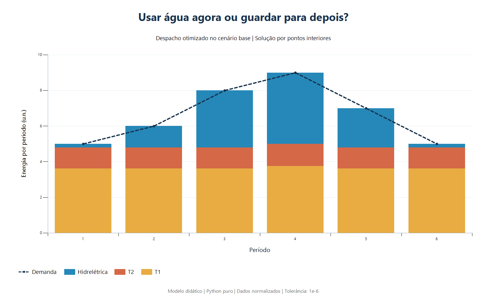
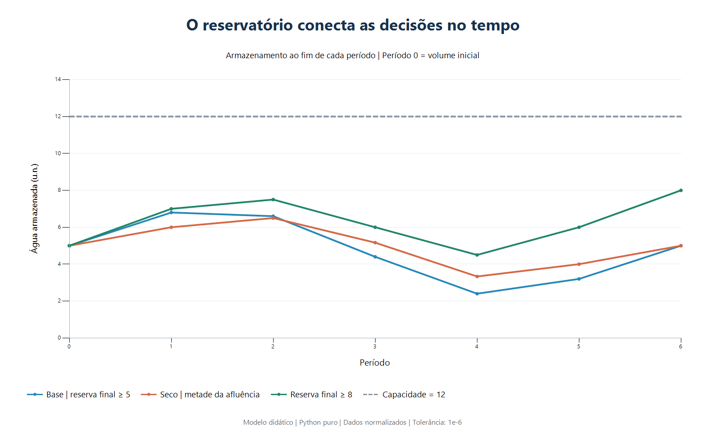
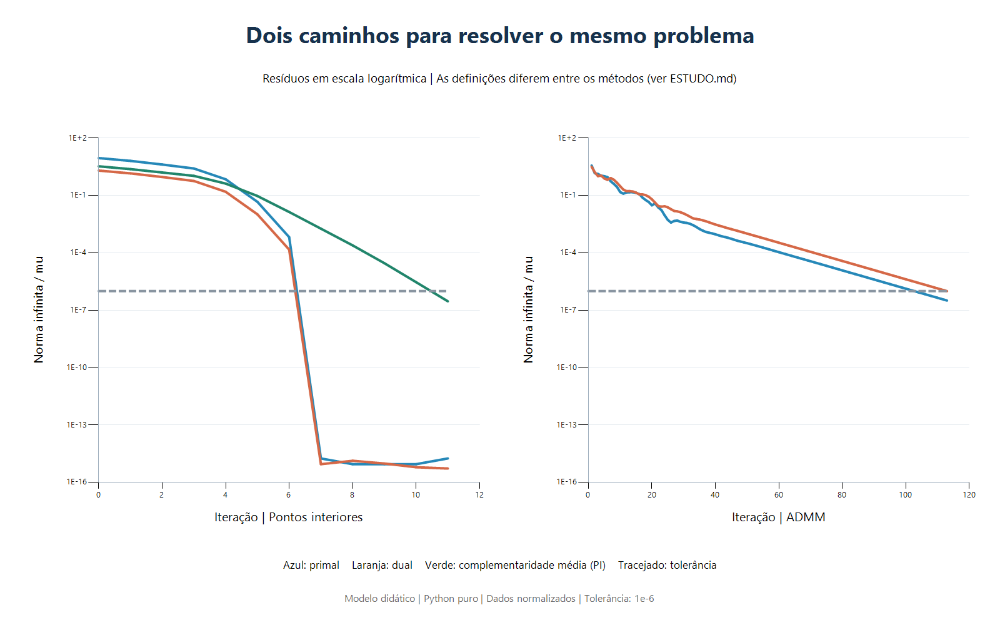
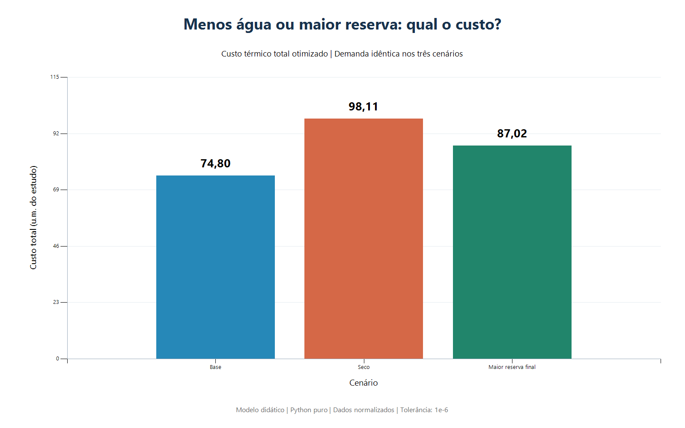

# Otimização hidrotérmica em Python puro

Estudo didático de um problema convexo de despacho hidrotérmico determinístico,
com um reservatório, várias térmicas e vários períodos. Implementa dois métodos
de solução sem dependências externas: pontos interiores primal-dual e ADMM.

O projeto parte de uma ideia inspirada no planejamento hidrotérmico associado ao
DECOMP. Esta implementação tem formulação própria, simplificada; não implementa
o DECOMP nem lê seus arquivos de entrada.

## Executar

Python 3.10 ou superior. No PowerShell, a partir da pasta do projeto:

```powershell
Set-Location '0. Convex Problem'
python main.py --scenario base --output results/base
python main.py --scenario dry --output results/dry
python main.py --scenario reserve --output results/reserve
python -m unittest -v
```

Não há pacotes para instalar. Os dados estão em `example()` no arquivo
`model.py`. O parâmetro `--rho` controla a penalidade do ADMM e
`--tolerance` controla a tolerância absoluta, com padrão de `1e-6`.

## Organização

- [model.py](<0. Convex Problem/model.py>): dados, formulação e balanços físicos.
- [solvers.py](<0. Convex Problem/solvers.py>): álgebra linear e algoritmos.
- [main.py](<0. Convex Problem/main.py>): comparação e exportação dos resultados.
- [test_model.py](<0. Convex Problem/test_model.py>): casos analíticos e verificações.
- [ESTUDO.md](ESTUDO.md): hipóteses, equações, algoritmos e roteiro de experimentos.

Os CSVs incluem despacho por algoritmo, histórico de convergência e resumo.
`metadata.json` registra os dados, os parâmetros e o ambiente da execução.
Os resultados gerados ficam fora do controle de versão.

## Primeira execução de referência

No cenário base, com tolerância `1e-6` e `rho=1`, ambos convergiram:

| Método | Iterações | Custo | Maior violação das restrições |
|---|---:|---:|---:|
| Pontos interiores | 11 | 74,80333567 | 6,7 × 10⁻¹⁶ |
| ADMM | 113 | 74,80333503 | 3,2 × 10⁻⁷ |

Os custos diferiram em aproximadamente `6,4e-7`. Uma pequena violação pode
permitir que o custo numérico fique abaixo do ótimo viável; compare custo e
viabilidade em conjunto. Esses números descrevem este exemplo, sem estabelecer
qual algoritmo é mais rápido em geral. Os cinco testes automatizados passaram.

## Gráficos do modelo

As imagens abaixo foram calculadas a partir do modelo; os dados numéricos
correspondentes estão em [figures/data](figures/data). Os PNGs têm 1600 × 1000
pixels e podem ser usados na publicação.









Para recalcular as imagens, execute na pasta `0. Convex Problem`:

```powershell
python figures.py
```

A exportação dos dados usa somente a biblioteca padrão do Python. A renderização
usa o componente de gráficos .NET do Windows PowerShell 5.1, sem instalar pacotes.
O modelo e os algoritmos também podem ser executados em outros sistemas; o
renderizador de PNG desta versão requer Windows. `figures.py` só publica dados
de soluções convergidas com violação das restrições de até `1e-6`.

O gráfico de convergência usa painéis separados porque os métodos têm resíduos
e custos por iteração diferentes. Valores abaixo de `1e-16` são limitados a esse
piso apenas no desenho logarítmico. Os CSVs preservam os valores calculados.
As trajetórias de armazenamento são as soluções retornadas por pontos interiores;
não se pressupõe unicidade de todas as variáveis hidráulicas.
